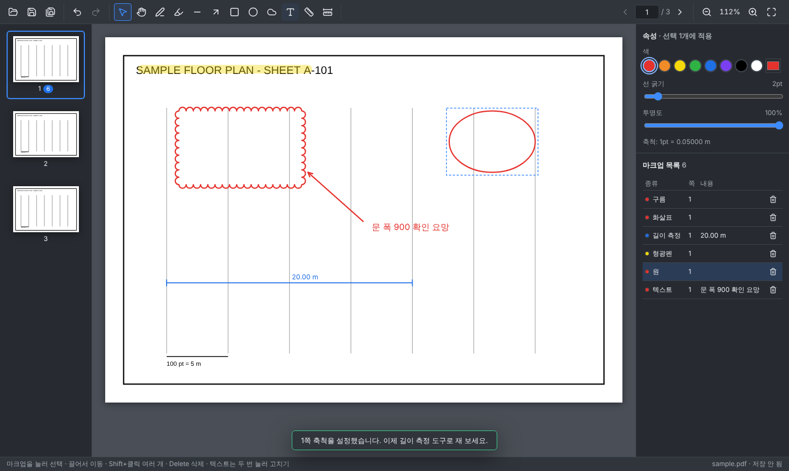

# blakpdf

Bluebeam Revu 비슷한 **PDF 마크업·측정 프로그램** (Windows). React + Electron.



## 할 수 있는 것
| 기능 | 방법 |
|---|---|
| PDF 열기 | 파일 > 열기 (Ctrl+O), 또는 창에 끌어다 놓기 |
| 페이지 이동 | 왼쪽 썸네일, ‹ › 버튼, 페이지 번호 입력, PageUp/PageDown |
| 확대/축소 | 돋보기 버튼, Ctrl+휠, Ctrl+0 = 폭 맞춤 |
| 마크업 | 펜(P) 형광펜(I) 선(L) 화살표(A) 사각형(R) 원(E) 구름(C) 텍스트(T) — Shift = 45° |
| 선택·이동·삭제 | 선택(V)으로 누르고 끌기, Shift+클릭 여러 개, Delete, 텍스트는 두 번 눌러 고치기 |
| 속성 | 오른쪽 패널: 색, 선 굵기, 투명도, 글자 크기 |
| 측정 | 축척 설정(K): 길이를 아는 두 점을 끌고 실제 길이 입력 → 길이 측정(M) |
| 마크업 목록 | 오른쪽 아래: 누르면 그 페이지로 이동, 휴지통 = 삭제 |
| 실행 취소 | Ctrl+Z / Ctrl+Y |
| 저장 | Ctrl+S → `원본이름_markup.pdf` (원본은 그대로) |

## 알려진 제한 (v0.1)
- 저장한 PDF의 마크업은 페이지에 그림으로 들어가서, 다시 열거나 다른 프로그램에서 편집할 수 없음 (원본 PDF는 그대로 둠)
- 면적·개수 측정, 연속 스크롤, 도면 비교는 아직 없음

## Windows에서 실행
1. [Node.js LTS](https://nodejs.org) 설치
2. PowerShell에서:
```
git clone https://github.com/samk83/blakpdf.git
cd blakpdf
npm install
npm run electron
```
설치 파일(.exe) 만들기:
```
npm run dist:win
```
→ `release` 폴더에 설치 파일과 포터블 exe가 생긴다. (서명이 없어 처음 실행 때 SmartScreen 경고가 뜨면 "추가 정보 > 실행")

## 개발
```
npm run dev
npm test
npm run test:e2e
```
자세한 명령·구조는 `CLAUDE.md`, 수락기준은 `docs/SPEC.md`.
